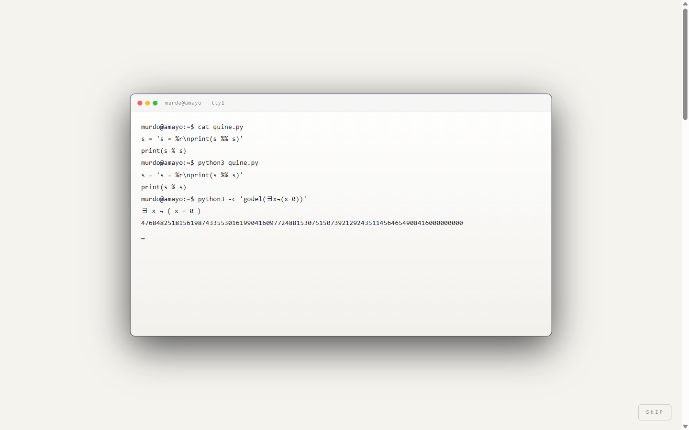
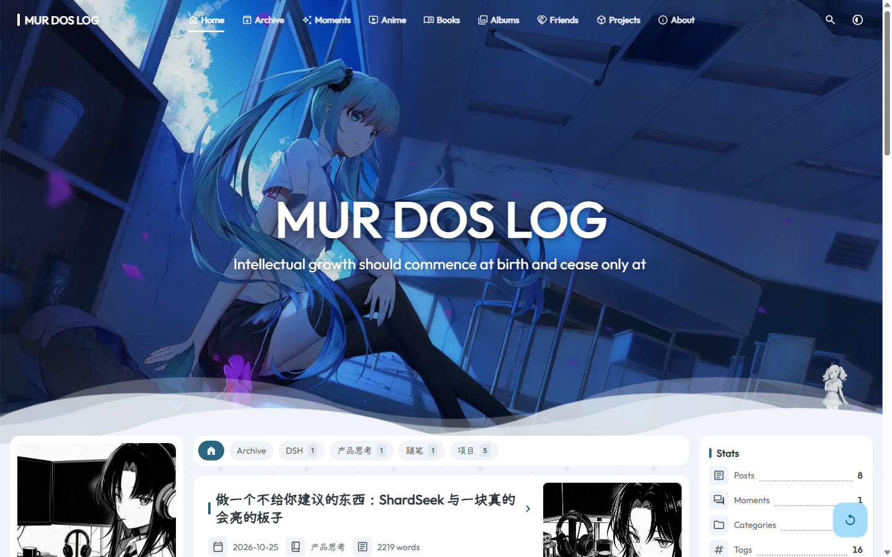
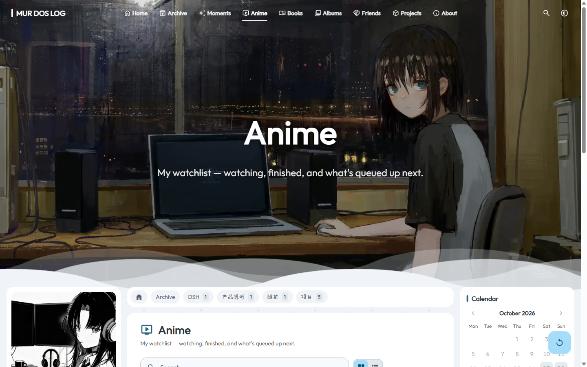
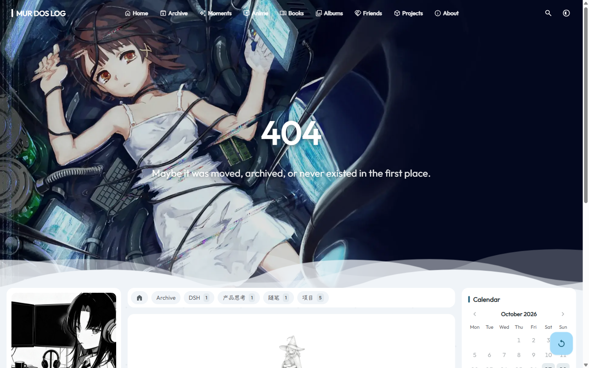

{width=68%}

{width=26%}

**《解密DeekSeek：从基础到创意实践》**

**实 验 报 告**

实验名称：个人博客 MUR DOS LOG 的设计、重构与部署

学　　号：262712025001

姓　　名：薛瑞

班　　级：食安2501

# 课程大作业报告大纲

## 一、项目概述

### 1.1 项目名称与作品形式

本项目名为 **MUR DOS LOG**，是部署在自有域名 `https://murdok.me` 上的个人博客，另提供 GitHub Pages 镜像 `https://rui-debug769.github.io`。作品形式为**可访问的静态网页项目**：站点由 Astro 7 在构建期生成静态页面，推送到 GitHub 仓库后经 Actions 自动构建，再 rsync 同步到云服务器，由 Nginx 对外提供访问。除首页与文章页外，站点还包含归档、碎碎念、追番、书单、相册、友链、项目、关于等栏目，以及 RSS/Atom 订阅、站点地图与全文搜索。

选择"网站"而非一段文本或一张图，是因为站点是少数能同时承载**内容、设计、交互与工程**四种成分的媒介：既要有东西可写，又要有样子可看，还要真的跑得起来。

### 1.2 选题背景

本人的项目记录长期散落在 GitHub 的 commit message、公众号草稿、飞书文档与零散的 Markdown 笔记中，彼此不通，检索困难，也没有统一的"门面"。同时，作为一个兼做 AI 工具开发与人文阅读的人，我希望有一个地方把两类内容放在同一套视觉语言下——写代码的周记和读过的书、追过的番，本来就是同一个人的两面。

另一方面，本课程的主题是"从基础到创意实践"。生成一段文字只需一次对话，而维护一个真实项目需要几十轮对话与上百次修改。后者才是更完整的"创意实践"。

### 1.3 目标用户与使用场景

- **本人**：日常写作与发布。新建一个 Markdown 文件、填写 frontmatter、`git push`，约 30 秒后线上生效。
- **同学与开发者**：通过搜索引擎或友链进入，了解我在做什么、读过什么。站点实际承担了"作品集入口"的功能。
- **课程评审**：验收作品是否可访问、功能是否完整、AI 协作过程是否真实可查。

传播场景包括搜索引擎收录、RSS 订阅、社交平台分享单篇文章，以及在简历与项目文档中作为个人站点引用。

### 1.4 选题原因与作品价值

这个选题的价值有三层。**载体价值**：把散落的内容收回到自有域名下，长期可控。**表达价值**：开场动画、配色体系与插画在表达"我是谁"，而不只是"我写了什么"。**方法价值**：整个项目是一次完整的 AI 协作工程实践——AI 承担大量实现，方向判断、审美取舍与验收始终由本人完成，恰好对应课程要我们思考的问题：**当 AI 能写代码之后，人的价值落在哪里。**

## 二、项目目标与方案设计

### 2.1 项目目标

1. **可长期维护的内容站点**：完成选型与骨架，迁移既有 8 篇文章并保证旧链接不断链。
2. **有个人辨识度的视觉与叙事**：不做通用模板换色版，要有原创开场、统一配色 token 与插画体系。
3. **可交互的"生活切片"栏目**：追番、书单、相册、碎碎念做成真实数据驱动，而非静态占位。
4. **工程可用性**：自动化构建部署、无障碍与端到端测试、SEO 与订阅，达到"可以给别人看"的完成度。

### 2.2 整体设计思路

站点分三层。**骨架层**解决"内容如何组织"：用 Astro 内容集合管理文章，文件系统路由生成页面，全站静态生成，交互部分以 Svelte 5 岛式水合；Swup 做无刷新转场，使页面切换时氛围不中断。

**主题层**解决"看起来是什么样"：采用 Material 3 Expressive 的 token 体系，颜色以 oklch 表示并支持动态调色板，可在 Tonal Spot、Vibrant、Expressive、Monochrome 等配色风格与五种背景纹理间切换；明暗各自独立一套变量，切换时以圆形扩散过渡。插画采用黑白漫画立绘与彩色手绘场景混排——黑白负责"冷静的知识"，彩色负责"有温度的生活"。

**叙事层**解决"第一眼记住什么"：进入时先播放 17 秒开场，随后落到站点标题与逐字浮现的引文，再进入内容流。

### 2.3 核心功能与模块结构

| 模块 | 主要功能 | 设计意图 |
|---|---|---|
| 开场动画 | 终端 quine → glitch 崩解 → 漫画格少女，可跳过、可重播 | 用"自指"作为站点母题 |
| 首页 | 标题、打字机引文、Hero 16 图轮换、分类胶囊、文章卡、统计与日历 | 一屏交代"我是谁 + 我写了什么" |
| 文章页 | Markdown/MDX、公式与代码高亮、浮动目录、字数与阅读时长 | 长文可读性优先 |
| 归档与标签 | 按时间、分类、标签、系列聚合 | 内容可被翻找 |
| 追番 / 书单 | 接入 Kazumi 的 WebDAV 数据；结构化书目与多语言文案 | 把私人爱好变成可维护的数据页 |
| 相册 / 碎碎念 / 友链 | 图像网格、短文本流、外部站点清单 | 降低发布门槛 |
| 数学彩蛋 | Gray-Scott 图灵斑图、正二十面体、交换图、Konami、Gödel 404 | 给同好留的暗号 |
| 看板娘 | Live2D 双角色，可拖动、位置按相对坐标持久化 | 让站点"活着" |
| 基础设施 | pagefind 搜索、RSS/Atom、sitemap、robots、llms.txt、备案页脚 | 可被发现、可被订阅 |

### 2.4 界面风格与操作流程

视觉上是"柔光 + 圆角 + 胶囊"的 M3E 语言，叠加黑白漫画的硬边与颗粒感；中文排版按行高与字距单独调校，代码块采用 macOS 窗口样式，所有控件保留焦点环与键盘可达性。

主要流程：进入站点 → 观看或跳过开场 → 首页浏览分类与文章卡 → 进入文章 → 通过导航进入追番、书单等栏目 → 搜索面板全文检索 → 右下角切换明暗与配色。"重播开场"始终可用。

### 2.5 开场动画的原创设计

开场是本站最具原创性的部分，也是投入最多的组件（`src/components/Intro.astro`，652 行），采用三段式：

1. **终端 quine**：macOS 窗口逐行打出 `cat quine.py` 与 `python3 quine.py`。所展示的 quine 程序**真实可运行**——运行输出与源码逐字重合（`s = 's = %r\nprint(s %% s)'; print(s % s)`）；随后执行哥德尔编码，输出一个真实的、位数极长的哥德尔数，作为"自指"的第二个例子。
2. **glitch 崩解**：终端画面故障式撕裂，崩解为黑白漫画分格。
3. **少女与符号**：漫画格中出现少女与硬核逻辑符号，收束到"自指的机器 → 自指的少女"。

总时长 17 秒，**分镜时长按质数编排（3/5/2/5/2）**，终端高亮行号取 2、3、5、7、11、13、17——质数"不能被更小的单位整除"，与自指同构。这些数字不是装饰，而是把主题编码进了节奏本身。

## 三、制作工具与实施过程

### 3.1 使用的工具

| 工具 / 平台 | 用途 | 说明 |
|---|---|---|
| Claude Code + DeepSeek API | 主要开发工具：架构、组件、重构、调试、文案初稿 | 客户端为 Claude Code，实际推理由 DeepSeek 系列模型接口提供；会话中可按任务切换档位 |
| 图像生成模型（Seedream 等） | 人物立绘、场景插图、封面素材 | 以"角色圣经"约束一致性，用真实命令行截图作参考 |
| 开源主题 Shirone（MIT） | 站点骨架与主题层基底 | 在其之上二次开发，改造范围见制作说明 |
| Astro 7 / Svelte 5 / Tailwind 4 / Stylus | 前端框架与样式 | 静态生成 + 岛式水合 |
| pnpm 9 / Biome / Playwright | 包管理、静态检查、端到端与无障碍测试 | 后期由 npm 迁移至 pnpm |
| GitHub Actions + rsync + Nginx | 持续部署 | push 触发构建并同步至服务器 |

需要说明工具链的实际构成：开发时用的是 Claude Code 客户端，但它背后的推理由 **DeepSeek 的模型接口**提供，会话中可按任务切换不同档位。也就是说，课程讲授的对象不是"背景知识"，而正是我实际调用的那个模型。

这让课程内容有了直接的用处：理解 MoE 稀疏激活，就能明白为什么同一段代码在不同档位下质量差别明显；理解 MLA 对 KV 缓存的压缩，就能预估长上下文重构的成本；理解推理链的展开方式，就知道什么时候该把需求写得更细、什么时候该把上下文压缩成一份文档重新喂进去。这些不是考点，而是我在几轮返工里真正用来做判断的依据。

### 3.2 实施过程

**第一阶段：v1 手写站点（10 月 17—19 日）。** 从零搭建 Astro 7 站点，完成首页三分类、文章集合、RSS 与 sitemap，接入 Actions 自动部署。随后进行视觉改造：墨线双色调剪影、雨后清晨浅色叙事、水墨远山与朱砂印章、樱瓣与 Konami 彩蛋，并搬入四张素描看板角色。

**第二阶段：收敛与修正（10 月 24—25 日）。** 看板娘从五位同台改为两位可自由拖动；修复桃濑日和图层重合；文章按周记口吻重写，去掉"AI 味"。

**第三阶段：v2 重构（10 月 25—28 日）。** 投入最大的一段。参考余弦、Shirone 等站点后，决定以开源主题 Shirone 为基底重建：迁移 8 篇文章并配置旧链重定向；重建站点标识与色彩体系；上线追番、碎碎念、相册、友链；移植数学彩蛋；补齐 Playwright 端到端与无障碍断言，修正开场遮罩对屏幕阅读器的影响。

**第四阶段：原创收尾（10 月 28 日）。** 重写开场——从"雨夜终端"改为"自指"叙事，实现真实 quine 与哥德尔数；新增"重播开场"；完成视觉资产轮换、favicon、书单多语言、Kazumi 数据同步；把部署管道从 npm 迁移到 pnpm，修复 banner 高度与立绘透明度等细节。

### 3.3 本人承担的工作与 AI 辅助的工作

这是我最想讲清楚的一件事：**AI 完成了绝大部分代码编写，但它没有完成"决定"。**

本人承担：技术选型与基底主题选定；参考站点的取舍；视觉方向的确立；每一条提示词的措辞与边界；对输出的逐条验收——拖动看板娘、切主题、缩放窗口、用屏幕阅读器走一遍、跑断言；判断"看不出问题但就是不对"时是否返工；以及事实核查（例如画面里的命令行必须是真实跑出来的结果）。

AI 承担：组件与页面的具体实现；重构与文件迁移；CSS 与动画调试；错误定位；文案初稿；测试用例编写。

一个具体的比例感受是：**每次让 AI 完成一个功能的成本，约等于把验收标准想清楚的成本。** 想清楚了，一次就过；想不清楚，就要来回五轮。

## 四、作品成果展示

作品已于 2026 年 10 月 28 日上线。主站：**https://murdok.me**；GitHub Pages 镜像：**https://rui-debug769.github.io**。以下截图取自主站，镜像内容一致。

{width=100%}

{width=100%}

{width=100%}

{width=100%}

{width=100%}

{width=100%}

{width=100%}

此外还有归档、碎碎念、相册、友链、项目、关于等页面，以及 RSS/Atom、sitemap、robots、pagefind 全文搜索与 llms.txt（供 AI 读取的站点索引）。

## 五、项目总结与学习体会

### 5.1 目标完成情况

| 目标 | 完成情况 | 说明 |
|---|---|---|
| 可维护的内容站点 | 达成 | 8 篇文章迁移完成，旧链重定向生效，push 即部署 |
| 有辨识度的视觉叙事 | 达成 | 原创自指开场、M3E 调色板、黑白漫画插画体系 |
| 生活切片栏目 | 达成 | 追番/书单/相册/碎碎念上线，追番接真实数据源 |
| 工程可用性 | 基本达成 | CI/CD、端到端与无障碍测试、SEO 与订阅完备；仍缺真实用户测试 |

### 5.2 主要不足与改进方向

**内容量偏少。** 上线时只有 8 篇文章，视觉做得很满，内容还是空的——后续应稳定写作频率，而不是继续雕琢页面。

**对上游主题依赖较重。** v2 建立在 Shirone 之上，省下大量基础工作，代价是上游升级时二次开发部分需重新合并。后续应把改动收敛成独立组件与配置文件。

**缺少真实用户验证。** 所有验收都是我自己的判断，没有做过陌生用户的可用性测试，这是目前最大的盲区。

**部署形态是双轨的。** 主站部署在自有云服务器（域名与备案、HTTPS 仍在推进），另设 GitHub Pages 镜像以满足课程要求。镜像由 Actions 每周拉取源码重建，canonical 仍指向主域名，因此它是备份而非 SEO 主入口——这种双轨本身也是一种维护负担。

### 5.3 对 AI 能力与局限的认识

**AI 极擅长把模糊意图变成可运行的东西。** 我说"参考 cosine 的前端优化一下我的博客"，它能自主读代码、定方案、改十几个文件、跑构建、修报错，直到跑通。这种"从意图到可运行"的转化速度，是我手工做不到的。

**AI 不擅长判断什么值得做。** 它会在我说"重新构建"之后一口气重构整个站点，却不会问"你真正想要的是换骨架，还是只想换个样子"。方向错了，它做得越快，返工越贵。本项目最大的教训是：**在让 AI 动手之前，先自己把"要什么"写成一句话。**

**AI 的"记得"是不可靠的。** 我在 10 月 27 日说过"背景有点太亮了"，到 10 月 28 日又说了两次"背景太亮了，之前应该有提过"——它在新会话里没有把这条约束带过来。后来我改成把审美约束写进文件（角色设定、设计 token），让它每次读文件而不是靠"记忆"。**能被写下来的约束才是约束。**

**AI 会给出"看起来更聪明"的错方案。** 立绘抠图时它先用了 `mix-blend-mode`，理论更优雅，实际让白衬衫透出底色；最终回到最笨的方案：不透明白底原图 + 边缘 1px 羽化。**当"聪明方案"连续两次失败，就该退回最笨的可行方案。**

### 5.4 提示词设计与结果筛选的收获

最有效的四件事：**给参照物而非形容词**——"参考 https://blog.cosine.ren/ 的前端"比"做得好看一点"有效一个数量级，附上本地素材目录比让它自由发挥稳得多；**用"确认 / ok / 全部通过"做门控**，先给方案等确认再动手，避免了大量返工；**把否定说清楚**——"初音、远雷圆、琪亚娜、流萤删去"比"角色少一点"精确得多；**要求"真实"而非"像"**——明确要求"调用真实的 Linux 命令行跑，把其中一段作为屏幕显示"，这个要求让开场从"氛围贴图"变成"真的在自指"。

在结果筛选上，判断标准从"看起来对不对"变成"跑起来对不对"：拖动看板娘、缩放窗口看是否错位、切换明暗看变量是否漏掉、用 Playwright 断言关键交互、查控制台报错。**能被我亲手操作一遍并验证的东西，才算完成。**

## 补充材料：AI 协作与迭代改进

本节从真实会话记录中抽取五个关键迭代节点，完整交互记录见附件 `AI交互记录.md`。

### 迭代一：看板娘从"五位同台"到"两位可拖动"

**问题**：底部舞台同时站了五位角色，拥挤且与正文争抢注意力。

**我的要求（原话）**：

> 洛天依的live2的用 https://github.com/SheepLiu712/Agent-LuoTianyi 里的，桃濑日和的不变。初音、远雷圆、琪亚娜、流萤删去。不要同时呈现在博客底部舞台，你把她们设置成可以自由拖动的样式

**AI 的输出**：删除四位角色的模型资源，把舞台改造为可拖拽组件，位置改为按相对右下角的坐标存储。

**我的判断**：接受删除与拖拽，但追加一条站位约束——「日和左边，天依右边」。这条追加来自实际观感：两位角色若随机初始站位，首屏构图会失衡。

**效果**：提交 `4bca695`「feat: 看板娘默认站位改为日和居左、天依居右」，窗口缩放后位置不再错位。

### 迭代二：日和图层重合——AI 连续两次失败

**问题**：桃濑日和在播放某些动作时，手臂图层与身体图层重合错位。

**第一轮（10-25 01:50）**：「请你解决一下日和的几个动作图层重合的问题」——AI 修改 CSS 层级与 z-index，部分动作下问题仍在。

**第二轮（10-25 02:09）**：「Try again」——仍未根治。

**第三轮（10-25 03:29）** 再次提出，并补了一句方向提示：从模型文件本身查——AI 发现缺少 `pose3.json`。

**我的判断**：问题不在渲染层，而在资源层。前两轮 AI 都在错误的层面上"优化"，而我只说了"再试一次"，没有给方向。**当 AI 在错误层面反复修补时，要改变提问的方向，而不是重复"再试一次"。**

**效果**：提交 `afb72c8`「fix: 修复桃濑日和手臂图层重合（补上缺失的 pose3.json）」。

### 迭代三：开场动画从"雨夜终端"到"自指"

**问题**：v1 的开场是通用的"雨夜终端"氛围动画，好看但与站点想表达的东西无关。

**我的要求（原话节选）**：

> 我希望重新构建我的intro以及相关的主题，更改掉雨夜终端相关的内容。请你通过与我反复对话确定我的需求……

以及在节奏上：

> 关于时间和密度你可以按照最符合自指这一概念的数字进行分配……以及使用Linux命令行里的Python

**AI 的输出**：三段式结构（终端 quine → glitch → 漫画格少女），总时长 17 秒，分镜按质数 3/5/2/5/2 编排，终端行号高亮取 2/3/5/7/11/13/17。

**我的判断**：接受结构，但追加硬约束——画面中的代码必须真实运行，不能是"看起来像终端"的贴图。

**效果**：提交 `013e806`「重建 intro——自指的机器→自指的少女（17s 质数分镜，真实 quine + 真实哥德尔数）」，开场从"氛围"变成"论证"。

### 迭代四：立绘抠图的三次返工

**问题**：黑白漫画立绘需叠在彩色背景上，边缘处理不当会出现白边或被底色染色。

**过程**：AI 首轮用 `mix-blend-mode`——理论更优雅，实际白衬衫透出背景色；改为「重抠立绘——人物区硬不透明 + 仅边缘 1px 羽化」，仍不理想；最终采用「少女立绘改为不透明白底原图」，提交 `650bc9a`。

**我的判断**：AI 倾向选择技术上更优雅的实现，而优雅在视觉上未必正确。判断标准必须是眼睛看到的最终效果。

### 迭代五：约束的遗忘与固化

**问题**：同一视觉约束被反复提出——「人没有问题，背景有点太亮了」（10-27 11:07），之后 10-28 又两次出现「背景太亮了，之前应该有提过」。

**我的判断**：这不是模型"不听话"，而是跨会话的上下文天然不连续。解决办法不是反复提醒，而是把约束**写进文件**——角色设定与设计 token（`DESIGN.md`），每次生成前让模型先读文件。

**效果**：后续图像生成与页面改造以文件中的约束为准，重复沟通显著减少。

### 关键迭代节点一览

| 时间 | 节点 | 问题 → 处理 → 结果 |
|---|---|---|
| 10-17 ~ 10-19 | v1 站点与视觉改造 | 零基础搭建 → AI 全量实现 → 可访问初版 |
| 10-24 | 看板娘收敛 | 五位同台拥挤 → 删四位 + 可拖拽 → 两位角色 |
| 10-25 | 图层重合修复 | CSS 层修补两次失败 → 转向模型文件 → 补 pose3.json |
| 10-26 ~ 10-27 | v2 重构 | 手写站维护成本高 → 以 Shirone 为基底重建 → 953 文件、32 次提交 |
| 10-27 | 数学彩蛋移植 | 彩蛋散落 → 统一移植 → 斑图/二十面体/交换图/Konami |
| 10-28 | 原创开场重建 | 氛围动画无意义 → 自指叙事 + 真实 quine → 17s 质数分镜 |
| 10-28 | 上线收尾 | 细节散乱 → 逐项修复 → 线上可用 |
